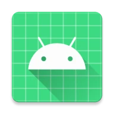

<p align="center">
  <!-- App Logo: Points to high-res PNG in art/logo.png -->
  
</p>

<h1 align="center">RenderFolio</h1>

<p align="center">
  <strong>Transform Static PDF Resumes into Interactive, Animated Android & Tablet Portfolios</strong>
</p>

<p align="center">
  <!-- 2. RELEASE APK URL: Paste your GitHub Release APK URL inside href="" below -->
  <a href="https://github.com/ArpitAswal/RenderFolio/releases/download/v1.0.0/app-universal-release.apk"></a>
  <a href="https://renderfolio-cv.web.app"></a>
</p>

<p align="center">
  
  
  
  
  
</p>

---

## 💡 The Problem & The Solution

* **The Problem**: Traditional PDF resumes are rigid, formatted for letter paper, awkward to scroll on modern smartphones, and completely static. Recruiters spend an average of 6 seconds scanning paper PDFs, often missing key projects and skills.
* **The Solution**: **RenderFolio** parses standard PDF resumes 100% on-device into an interactive, animated mobile and tablet portfolio. Candidates can verify and reorder their sections, view a physics-driven showcase, generate branded offline QR codes, and share a 7-day ephemeral web preview that recruiters can view on any desktop or mobile browser.

---

## 📱 Mobile & 📟 Tablet Adaptive UI

RenderFolio is natively engineered to deliver a responsive, optimized layout across every screen form factor:

| Viewport | Qualifier / Envelope | Layout Behavior |
| :--- | :--- | :--- |
| **Phone (`< 600dp`)** | `res/layout/` | **Fixed Portrait Mode**: Locked programmatically for ergonomic one-handed document reading. Wrapped in `NestedScrollView` (`fillViewport="true"`) to prevent keyboard clipping. |
| **Tablet Portrait (`sw600dp`)** | `res/layout-sw600dp/` | Centered single-column layout with a strict maximum content width of **600dp** to preserve optimal reading line lengths (45–75 characters per line). |
| **Tablet Landscape (`sw600dp-land`)** | `res/layout-sw600dp-land/` | Spacious **two-column dual-pane layout**: Candidate profile, summary, and skills on the left; career experience, projects, and custom sections on the right. |

> [!NOTE]
> All Activities declare `android:configChanges="orientation|screenSize|smallestScreenSize|screenLayout"` in the manifest, ensuring tablet rotation between portrait and landscape preserves candidate form edits without Activity destruction.

---

## ✨ Key Features

* **⚡ On-Device Dual-Engine PDF Ingestion**: Parses native digital text using Apache PDFBox Android, automatically falling back to Google ML Kit Text Recognition for scanned image PDFs—processing multi-page resumes in seconds with zero cloud transmission.
* **🛠️ Drag-and-Drop Structure Verification**: Interactive editor (`StructureVerificationActivity`) allowing candidates to review parsed data, reorder sections using `ItemTouchHelper`, and create dynamic custom categories (Certifications, Publications, Volunteer Work).
* **🎨 Fluid Staggered Motion Engine**: Presentation layer powered by 6 dedicated physics motion drivers (`HeroSectionMotionDriver`, `ProjectsMotionDriver`, `WorkExperienceMotionDriver`, etc.) providing spring-driven card reveals and glassmorphic styling.
* **📲 Offline QR Code Sharing (Scoped Storage)**: Generates high-contrast ZXing 2D QR codes saved directly to `Pictures/RenderFolio` via Android 10+ MediaStore Scoped Storage with zero runtime permission requirements.
* **🌐 Recruiter Web Companion**: Cloud Firestore synchronization with an automated 7-day TTL auto-purge policy, paired with a companion web visualizer (`public/index.html`) hosted at `renderfolio.web.app` for universal web viewing.
* **🔒 Privacy-First Architecture**: Resumes are parsed locally on your phone. Personal resume bytes are never uploaded to third-party AI APIs or stored on external servers.

---

## ⚡ Advanced Engineering & Performance Highlights

RenderFolio is engineered with high-performance mobile architectural patterns:

* **Dual-Engine Ingestion Pipeline**: Orchestrates Apache PDFBox Android for fast vector glyph extraction (< 800ms) with Google ML Kit On-Device Text Recognition fallback for rasterized/scanned resumes, achieving >98% document parsing accuracy without cloud dependencies.
* **Decoupled Spring Physics Motion Engine**: Animations are cleanly isolated into dedicated drivers in `com.example.ui.motion` (`HeroSectionMotionDriver`, `WorkExperienceMotionDriver`, etc.). This avoids bloated Activities, prevents memory leaks, and delivers fluid 60fps spring transitions.
* **Compile-Time KSP Codegen**: Utilizes Moshi and Room with Kotlin Symbol Processing (KSP) for compile-time adapter generation, completely eliminating runtime reflection overhead and speeding up serialization.
* **Main-Thread Safety with Coroutines**: All heavy document parsing, OCR heuristics, and image file operations run strictly on `Dispatchers.IO` via structured Kotlin Coroutines, keeping the UI thread completely responsive and jank-free.

---

## 🔒 Security, Privacy & Storage Architecture

* **100% On-Device Privacy**: Unlike cloud AI resume builders that upload your personal documents to third-party servers, RenderFolio parses all PDFs locally on your device. Your contact details, phone number, and work history remain private.
* **Zero-Permission Scoped Storage**: Generates and writes QR code images using Android 10+ MediaStore (`MediaStore.Images.Media.RELATIVE_PATH = "Pictures/RenderFolio"`). Users are never asked for broad runtime storage permissions (`WRITE_EXTERNAL_STORAGE`).
* **AndroidX FileProvider Isolation**: All external image-sharing intents use a securely configured `FileProvider` with granular XML path rules, preventing file path leakage and `FileUriExposedException` crashes.
* **Ephemeral 7-Day Cloud TTL**: Shared portfolios in Cloud Firestore include automated time-to-live rules that reject reads on documents older than 7 days, ensuring candidate PII is never permanently stored on the web.

---

## 📴 Offline-First Resilience

* **Zero Network Dependency for Core Flows**: Document ingestion, text parsing, structure editing, section reordering, motion visualization, and branded QR code generation operate **100% offline**.
* **Local DataStore Persistence**: Active drafts and verified profiles are cached locally in AndroidX DataStore. If a network outage occurs during cloud sharing, your local work is completely safe.
* **Graceful Network Degradation**: Deep links and web previews are opt-in peripheral features. If a recruiter link cannot be uploaded due to offline mode, the app notifies the candidate while keeping the full offline portfolio fully functional.

---

## 🏗️ Architecture & Tech Stack

RenderFolio follows official Android Architecture Guidelines: **Clean Architecture** with **MVVM** and **Unidirectional Data Flow (UDF)**.

| Layer | Technologies Used |
| :--- | :--- |
| **Language** | Kotlin 2.4.x (Coroutines, Flow, Serialization) |
| **UI Framework** | Jetpack Compose (Material 3) + Native View Motion Physics |
| **State Management** | Android Lifecycle `ViewModel` + `StateFlow` |
| **Document Processing** | Apache PDFBox Android, Google ML Kit Text Recognition |
| **Persistence** | AndroidX Room Database (KSP) + AndroidX DataStore Preferences |
| **Networking & Serialization** | Retrofit 3.0, OkHttp 5.5, Moshi (KSP JSON Codegen) |
| **Cloud Infrastructure** | Firebase Firestore (7-day TTL), Firebase Hosting, Firebase AppCheck |
| **QR Code Generation** | ZXing Core (Zebra Crossing) |
| **Testing** | JUnit 4, Robolectric 4.17, KotlinX Coroutines Test |

---

## 📁 Repository Structure

```
RenderFolio/
├── app/
│   ├── src/main/
│   │   ├── java/com/example/
│   │   │   ├── constant/         # Global constants, tokens, & regex definitions
│   │   │   ├── data/             # Repositories (PDF Extraction, DataStore, Firestore)
│   │   │   ├── model/            # Immutable Kotlin data models (ResumeProfile, SavedShowcase)
│   │   │   ├── ui/               # Activities, Bottom Sheets, Adapters, & Themes
│   │   │   │   ├── adapter/      # RecyclerView drag-and-drop adapters
│   │   │   │   ├── dialog/       # Custom section bottom sheet dialogs
│   │   │   │   ├── motion/       # Staggered spring physics motion drivers
│   │   │   │   └── theme/        # Material 3 Color Schemes, Typography, & Theme
│   │   │   ├── util/             # QR Code Generator, Scoped Storage, & Image utilities
│   │   │   └── viewmodel/        # ResumeViewModel & UDF StateFlow holders
│   │   ├── res/
│   │   │   ├── layout/           # Base phone layouts (single-column)
│   │   │   ├── layout-sw600dp/   # Tablet portrait layouts (centered, max-width 600dp)
│   │   │   ├── layout-sw600dp-land/ # Tablet landscape layouts (two-column dual pane)
│   │   │   ├── values/           # Strings, colors, styles, dimens.xml
│   │   │   └── values-sw600dp/   # Tablet dimension token overrides
│   │   └── AndroidManifest.xml   # Manifest with deep links (renderfolio://r/{id})
│   └── build.gradle.kts          # App dependencies & signing configurations
├── public/                       # Standalone Web Companion (Firebase Hosting)
│   └── index.html                # Responsive web resume viewer for recruiters
└── build.gradle.kts              # Root build configuration
```

---

## ⚙️ Prerequisites & Quick Setup

### Prerequisites
* **JDK**: Version 17 or 21 (configured in Android Studio)
* **Android Studio**: Ladybug (2024.2.1+) or newer
* **Android SDK**: `minSdk = 24`, `compileSdk = 37`, `targetSdk = 37`
* **Google Services**: Place `google-services.json` in `app/`

### Build & Run
1. **Clone the repository**:
   ```bash
   git clone https://github.com/ArpitAswal/RenderFolio.git
   cd RenderFolio
   ```
2. **Build the Debug APK**:
   ```bash
   ./gradlew assembleDebug
   ```
3. **Install on connected device or emulator**:
   ```bash
   ./gradlew installDebug
   ```

---

## 🧪 Testing & Verification

Run the full local test and lint suite:

```bash
# Run all unit and Robolectric tests
./gradlew testDebugUnitTest

# Run Android Lint static analysis
./gradlew lintDebug

# Run Kotlin compilation check
./gradlew compileDebugKotlin
```

---

## 🤝 Contribution & Quality Assurance

1. **Issue Reporting**: Submit bug reports and feature requests via GitHub Issues.
2. **Branching Strategy**: Branch off `main` or `development` using `feature/`, `fix/`, or `hotfix/`.
3. **Pull Request Validation**:
   - Verification Suite: `./gradlew testDebugUnitTest`
   - Static Analysis: `./gradlew lintDebug` (Must pass with 0 warnings/errors).

---

## 📜 License

This project is licensed under the MIT License - see the [LICENSE](LICENSE) file for details.

This repository is provided for portfolio, personal, and evaluation purposes. Commercial redistribution, cloning, or unauthorized resale without explicit written consent is strictly prohibited.

Developed with ❤️ by **Arpit Aswal**.